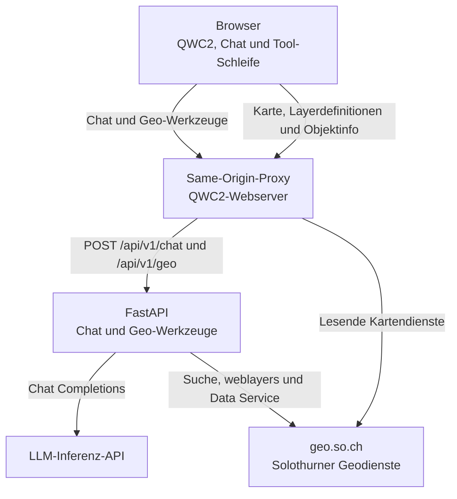
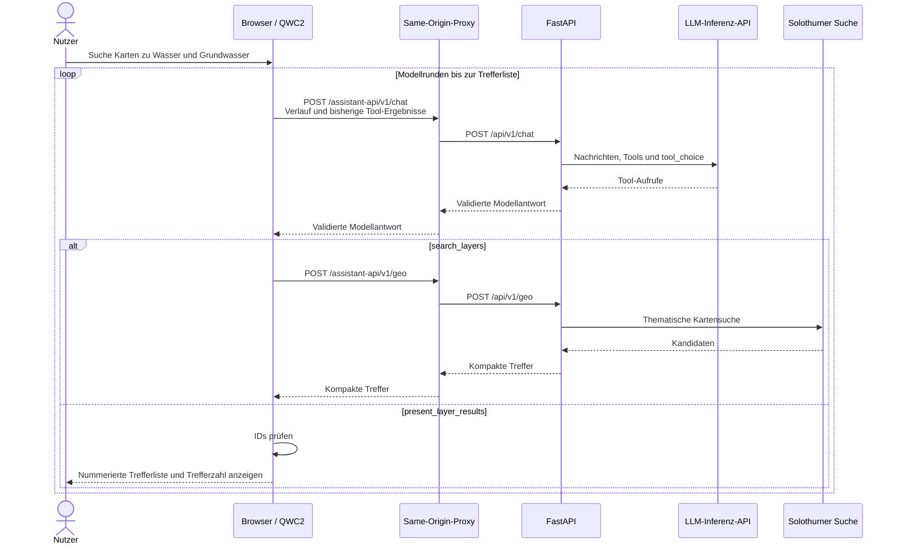

# QWC2-KI-Assistent für Solothurn

Der lokale Kartenclient verwendet die öffentliche Konfiguration, Karten- und
Suchdienste von geo.so.ch. QWC2 stammt aus dem
[Solothurner Referenzprojekt](https://github.com/edigonzales/qwc-kartenkatalog/tree/d945114f3ff7bcb582d4c8ddd9c0f25464dcb455)
und verwendet dessen unveränderte Version `qwc2-lts@2026.0.30`. Die BSD-Lizenz
steht in [frontend/LICENSE](frontend/LICENSE).

FastAPI vermittelt den Chat an die OpenAI-kompatible LLM-Inferenz-API und
fragt die Solothurner Suche, `weblayers` und den Data Service ab. Der
Browser ruft die Geo-Werkzeuge über `/assistant-api/v1/geo` auf. QWC2
führt Kartenaktionen aus und lädt Legenden und Objektinformationen über
seine gewohnten Dienste. Der Chatverlauf lebt im Browser und wird beim
Neuladen verworfen.

## Architektur



### Ablauf einer Wassersuche



## Lokal starten

Voraussetzungen sind Docker Compose, Internetzugang und für den Host-Modus
Node.js 22.13 oder neuer. Die verwendete Node-Version steht in [.nvmrc](.nvmrc).

Führe die Befehle im Repository-Verzeichnis aus. Der erste Befehl legt bei
einem frischen Checkout die lokale `.env` aus der Vorlage an.

```sh
test -e .env || cp .env.example .env
npm run setup
npm run dev
```

`npm run dev` startet FastAPI in Compose und QWC2 mit Hot Reload auf dem
Host. Strg+C beendet den Host-Prozess.

Für den vollständigen Containerbetrieb den Host-Prozess beenden und
`docker compose up --build` starten. `docker compose down` entfernt die
Container dieses Projekts.

[Karte öffnen](http://127.0.0.1:8082/map/) ·
[Gemeindegrenzen laden](http://127.0.0.1:8082/map/?l=ch.so.agi.gemeindegrenzen)

Die Dienste verwenden Loopback-Ports. Bei Portkonflikten `QWC_PORT` oder
`ASSISTANT_PORT` in der lokalen `.env` anpassen (Standard 8082 und 8083).
Verwende dann auch bei den Prüfbefehlen die angepassten Ports.

Karte, Geo-Endpunkt und Tests funktionieren mit leeren Infomaniak-Werten. Für
den Live-Chat `INFOMANIAK_API_TOKEN`, `INFOMANIAK_PRODUCT_ID` und
`INFOMANIAK_MODEL` in der gitignorierten `.env` setzen. Compose übergibt
diese Werte an FastAPI. Das Modell muss auf dem gewählten Produkt
verfügbar sein und Function Calling unterstützen.
Mit `Qwen/Qwen3.8-27B-FP8` wurden Modellliste, Text und Function Calling
am konfigurierten Testprodukt mit `temperature=0.2` und
`reasoning_effort=none` geprüft. [Infomaniak API](https://developer.infomaniak.com/docs/api/post/2/ai/%7Bproduct_id%7D/openai/v1/chat/completions)

## Karte und Chat

Über **Karte & Werkzeuge → KI-Assistent** öffnet sich die rechte Seitenleiste.
Beispiele für Anfragen:

- «Wo ist meine Karte zentriert und welche thematischen Layer sind sichtbar?»
- «Suche Karten zu Wasser und Grundwasser im Kanton Solothurn.»
- «Suche Hübeli.»
- «Gehe zu Klosterplatz 1 in Solothurn.»
- «Gehe zum Grundstück 123 in Bellach.»
- «Lade den Layer mit den Altlasten und gehe zu Grundstück 2084 in Solothurn.»
- «In welchem Gewässerschutzbereich liegt Klosterplatz 1 in Solothurn?»
- «Mehr Informationen zu Nummer 2.»
- «Zeige Nummer 2 auf der Karte.»
- «Entferne den Layer Gemeindegrenzen.»
- «Zentriere die Karte auf LV95 2607100 Ost und 1228400 Nord im Massstab 1:10000.»

**Details** liest die Metadaten eines Kartentreffers. **Anzeigen** schaltet
einen Layer ein oder zoomt auf einen Objekttreffer. Nummern im Chat beziehen
sich auf die letzte Layerliste. Die Objektsuche verwendet die Volltextfilter
des aktuellen Kartenthemas ohne `foreground`. Nach einem Navigationsbefehl
zoomt QWC2 bei vollständig ausgewertetem, eindeutigem Treffer auf ca. 1:1000
für Adressen oder auf den ganzen Suchausschnitt für Grundstücke. Bei mehreren
Treffern oder einer gekürzten Liste kannst du einen Eintrag direkt auswählen
oder den Befehl mit Ort, Objektart oder Grundbuchkreis präzisieren.
Das Modell meldet die GIS-Aufträge einer Nachricht und ordnet seine Aufrufe
dem jeweiligen Auftrag zu. Der Server prüft die Argumente und Nachweise
pro Auftrag. Bei einer Rückfrage kann der Chat einen anderen eindeutigen
Auftrag bereits ausführen. Die Antwort auf die Rückfrage setzt den offenen
Auftrag mit einer frischen Suche fort.

Pro Nachricht sind vier Modellrunden und acht Tool-Aufrufe möglich.
Davon sind höchstens drei Karten- oder Objektsuchen zulässig.
Die Objektsuche liefert bis zu 25 Treffer pro Aufruf. Bei der Kartensuche
sortiert das Modell bis zu 40 eindeutige Kandidaten und kann bis zu
zehn davon anzeigen. Der Browser prüft die IDs gegen die aktuellen Treffer.
Bei einer reinen Kartensuche endet der Zug mit der erfolgreichen Präsentation
der Liste. Eine Suchwiederholung bei leeren Treffern kann eine zusätzliche
Modellrunde erfordern.
[Suchmessung mit zehn Fachfragen](docs/search-quality.md)

## Einstiegspunkte im Code

- Die Chat-Seitenleiste rendert Nachrichten, Treffer und Direktaktionen. [AIChatPlugin.jsx](frontend/js/plugins/AIChatPlugin.jsx)
- Browser und FastAPI lesen die Tool-Schemas und Grenzen aus derselben Datei. [tools.json](shared/tools.json)
- Host- und Containerbetrieb nutzen dieselben Proxy-Routen für Live-Karte, Geo-Werkzeuge und Chat. [remote.cjs](frontend/server/remote.cjs)
- FastAPI validiert Toolargumente, liest die kantonalen Dienste und vermittelt Modellaufrufe an die Inferenz-API. [app.py](assistant/app.py)

## Prüfen

```sh
npm test
curl -fsS http://127.0.0.1:8082/assistant-api/v1/geo \
  -H 'Content-Type: application/json' \
  -d '{"name":"search_layers","args":{"query":"Grundwasser"}}'
curl -fsS 'http://127.0.0.1:8083/healthz'
docker compose exec -T assistant env -u INFOMANIAK_API_TOKEN -u INFOMANIAK_PRODUCT_ID -u INFOMANIAK_MODEL python - < assistant/test_chat.py
```

### Browser-Check mit Live-Chat

1. Öffne die Karte mit konfiguriertem Infomaniak-Zugang und wähle
   **Karte & Werkzeuge → KI-Assistent**.
2. Sende «Suche Karten zu Wasser und Grundwasser im Kanton Solothurn.»
   Der Chat zeigt eine nummerierte Liste mit bis zu zehn Kartentreffern.
3. Klicke bei einem noch nicht sichtbaren Treffer auf **Details**. Unter
   dem Treffer erscheint die Layer-ID. Klicke dort auf **Anzeigen**.
   Unter **Kartenebenen und Legende** erscheint der Layer als aktiv.
   Bei Gruppen können dort die aktiven Unterlayer erscheinen.
4. Öffne den KI-Assistenten erneut und sende «Entferne Nummer 2», wobei
   du die Nummer des angezeigten Treffers verwendest. Der Chat bestätigt
   die Entfernung und der Layer verschwindet aus Karte und Ebenenbaum.
5. Frage «In welchem Gewässerschutzbereich liegt Klosterplatz 1 in Solothurn?».
   Die Antwort nennt den am aufgelösten Punkt abgefragten Bereich `Au`.

## Debugging

Im Netzwerk-Tab siehst du die Aufrufe des Browsers an `/assistant-api/v1/chat`
und `/assistant-api/v1/geo`. Der Modellaufruf an Infomaniak läuft in FastAPI.
Für diesen Aufruf kann FastAPI der Chatantwort ein Diagnosefeld hinzufügen.

Setze `ASSISTANT_DEBUG=1` in der lokalen `.env` und übernimm die Einstellung
mit `docker compose up -d assistant`. Aktiviere dann im gewünschten Tab die
Inhaltsansicht in der Browserkonsole und sende eine Frage.

```js
sessionStorage.setItem('qwc-ai-debug', 'content')
```

Aktiviere in der Konsole die Debug- oder Verbose-Ausgabe und filtere nach
`[QWC KI]`. `chat.request` und `geo.request` zeigen die Browseraufrufe,
`chat.backend` den Modellaufruf und `tool.result` sowie `chat.display` die
Ausführung und Anzeige.
Bei `content` enthält `chat.backend` die gesendeten Modellnachrichten und die
sichtbare Modellantwort als Vorschau unter `payload.json`. Bei
`payload.truncated: true` enthält das Feld nur den Anfang des JSON-Texts.
Für Metadaten verwende `meta`.
Mit `sessionStorage.removeItem('qwc-ai-debug')` schaltest du die Ausgabe aus.

FastAPI schreibt pro Chat- und Geo-Aufruf eine JSON-Zeile auf `stdout`.
Mit `ASSISTANT_DEBUG=1` enthält sie zusätzlich Provider- oder Geo-Diagnosen.
`turn_id` und `round` verbinden den Eintrag mit der Browserkonsole. Direkte
Trefferaktionen erhalten eine eigene `turn_id`. Scheitert der Aufruf schon
im Browser oder Proxy, gibt es dazu keinen FastAPI-Eintrag.

```sh
docker compose logs --no-log-prefix --no-color -f assistant
```

`ASSISTANT_DEBUG_PAYLOAD=1` ergänzt bei aktivem Server-Debug auch auf `stdout`
eine begrenzte Textvorschau. Dafür ist keine aktivierte Browserkonsole nötig.
FastAPI schwärzt den konfigurierten Infomaniak-Token und lässt HTTP-Header
weg. Die Vorschau kann Fragen, Verlauf, Adressen und im Chat eingegebene
Zugangsdaten enthalten. Docker kann diese Inhalte speichern.
Setze beide Variablen auf `0` und führe `docker compose up -d assistant` aus,
um die zusätzlichen Server-Diagnosen abzuschalten.

## Grenzen

Die App liest öffentliche Kartenkonfigurationen, Kartenbilder und WMTS,
Suchtreffer, Layerdefinitionen, Objektinformationen, Legenden und Daten.
Für öffentlichen Betrieb wären Authentifizierung, Missbrauchs- und
Kostenlimits sowie Berechtigungsprüfungen erforderlich.

Die Fachabfrage unterstützt Adressen und LV95-Punkte für direkt abfragbare
Data-Service-Datensätze. Grundstücksflächen und amtliche ÖREB-Auszüge sind
weitere Anwendungsfälle. Die Kartensuche hängt von den publizierten Metadaten
und Suchbegriffen ab. [Reale Prüfungen und Reviewstand](docs/review.md)
